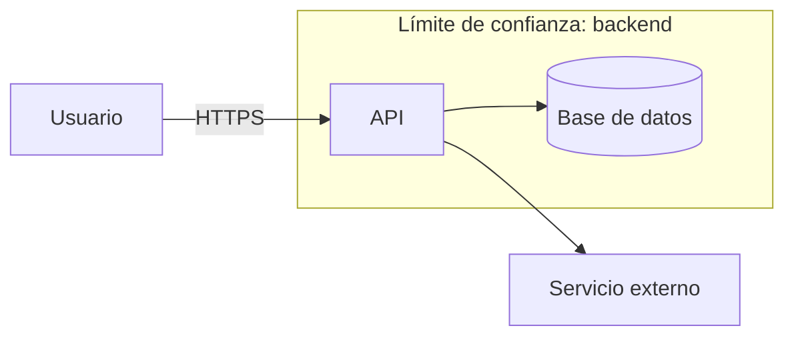

# Threat Model: <feature / sistema>

**Fecha:** <AAAA-MM-DD> · **Responsables:** <equipo> · **Versión:** 1.0

## 1. Alcance y objetivos de seguridad
- Qué se modela:
- Qué NO:
- Objetivos (confidencialidad, integridad, disponibilidad, privacidad, no repudio):

## 2. Activos y clasificación
| Activo | Clasificación | Dueño | Notas |
|---|---|---|---|
| | Confidencial/Restringido | | |

## 3. Actores
- Legítimos: usuario, admin, soporte, servicio...
- Adversarios: atacante anónimo, usuario malicioso autenticado, insider, proveedor comprometido, bot/fraudster.

## 4. Diagrama de flujo de datos (DFD)

**Límites de confianza:** <internet→backend, backend→DB, backend→terceros, tenant A↔B...>

## 5. Amenazas (STRIDE) y controles
| ID | Elemento / flujo | Cat. | Amenaza | Prob. | Impacto | Riesgo | Mitigación / control | Test/Verificación | Estado |
|---|---|---|---|---|---|---|---|---|---|
| T-01 | | S | Suplantación de identidad | M | A | Alto | MFA, rate limit | test authN | Pendiente |
| T-02 | | T | Manipulación de datos | | | | | | |
| T-03 | | R | Repudio | | | | Auditoría inmutable | | |
| T-04 | | I | Fuga de información | | | | | | |
| T-05 | | D | Denegación de servicio | | | | | | |
| T-06 | | E | Elevación de privilegios | | | | | | |

Para privacidad, agregar amenazas LINDDUN (vinculación, identificación, no repudio indebido, detección, divulgación, desconocimiento, incumplimiento).
Para abuso de negocio, agregar *abuse cases* (→ references/11).

## 6. Requisitos de seguridad derivados
- [ ] REQ-SEC-01:
- [ ] REQ-SEC-02:

## 7. Riesgo residual y supuestos
- Riesgos aceptados (quién, hasta cuándo):
- Supuestos de seguridad (p. ej. "el IdP verifica emails"):

## 8. Revisión
- Disparadores de re-modelado: cambio de arquitectura, nuevo tercero, nuevo tipo de dato sensible, incidente.
